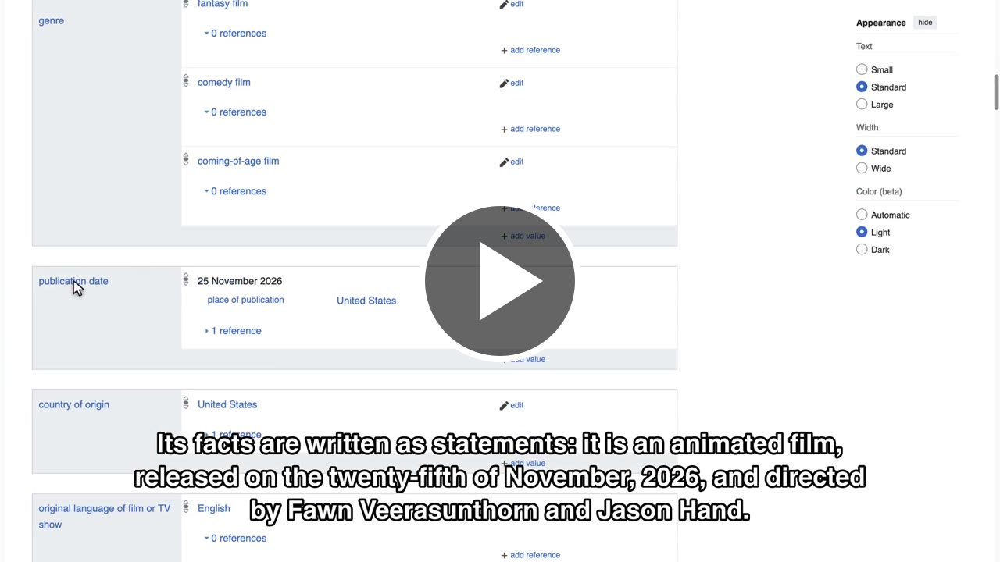

# product-demo

A [Claude Code](https://claude.com/claude-code) skill that turns a short description of
your product, or of a new release, into a **narrated, subtitled demo video**. The agent
drives a real Chrome browser, and you can watch the cursor move, the clicks and the key
presses. It voices the narration and edits the recording so that each action happens as
the voice talks about it.

## Sample

[](docs/sample/wikidata-tour.mp4)

*Click the image to play `docs/sample/wikidata-tour.mp4` (48 s, subtitles burned in).*

The whole request was one line:

```
/product-demo record a sample video for https://www.wikipedia.org -> https://www.wikidata.org/wiki/Wikidata:Main_Page -> https://www.wikidata.org/wiki/Q136027913
```

The agent proposed the scenes and the narration, waited for approval, then recorded and
edited the video. The spec it wrote is in [`docs/sample/demo.json`](docs/sample/demo.json),
and the subtitles are in [`docs/sample/wikidata-tour.srt`](docs/sample/wikidata-tour.srt).

> **The voice can sound much better.** The sample uses macOS `say`, which is free and
> offline but robotic. Set `OPENAI_API_KEY` or `ELEVENLABS_API_KEY` and set
> `"voice": { "backend": "openai" }` or `"elevenlabs"` in the spec (or pass `--backend` to
> `tts.py`), and the same demo gets natural narration. Nothing else changes.

## Why

Making a demo video by hand eats an afternoon: you write a script, record and re-record
the screen, record the voice, line the two up and add subtitles. Each release means doing
it all again.

With this skill, you tell the agent in a couple of sentences what is new and where it
lives. For example: *"We shipped CSV export on the Reports page. Show a customer how to
export last month's report."* The agent then:

1. asks for anything missing: the audience, the pages, the key message of each, and
   whether they need a login;
2. writes the narration and shows it to you for approval before recording anything;
3. records the walkthrough in Chrome, with a visible cursor, click ripples, keycaps and
   Back badges;
4. cuts out the dead time, starts each action on the phrase that mentions it, and burns
   in the subtitles;
5. checks the result (length, overlay effects, sync) before handing it over.

You get `final.mp4`, `final.srt` and `transcript.md`, ready to send to customers with
the release notes.

## How it works

- **Narration first.** The voice track is generated before recording, so each scene's
  length is known in advance.
- **Record, then edit.** The agent pauses for seconds between browser actions, so the raw
  recording is mostly frozen frames. Compose drops them and keeps only the motion.
- **Actions on cue.** Each action in the spec can name an `at` phrase from the narration.
  While recording, the agent marks a beat before that action. Compose then holds the
  screen until the voice reaches the phrase.
- **Exact alignment.** Right after recording starts, the overlay flashes the page magenta
  for a moment. Compose finds that frame and uses it to line the timeline up with the
  video.
- **Fitting.** If a scene's motion runs out before its narration does, compose holds the
  last frame. If the motion runs long, it speeds the video up to 1.5×, then adds silence
  to the audio.

Design decisions are recorded in [`docs/adr/`](docs/adr/).

## Requirements

- Claude Code with the [Chrome DevTools MCP](https://github.com/ChromeDevTools/chrome-devtools-mcp):
  `claude mcp add chrome-devtools -- npx -y chrome-devtools-mcp@latest`
- `python3` (3.11+) and `ffmpeg`
- Optional: `rsvg-convert` (`brew install librsvg`), needed to burn in subtitles only when
  your ffmpeg lacks libass
- Optional: `OPENAI_API_KEY` or `ELEVENLABS_API_KEY` for better voices (macOS `say` is the
  default)

## Install

Clone the repo into your Claude Code skills folder:

```
git clone https://github.com/ccomkhj/product-demo ~/.claude/skills/product-demo
```

Then, in the project where demos should be saved, run Claude Code and ask:

```
/product-demo <what to demo, which pages, for whom>
```

Each demo is written to `demos/<slug>/` under the current directory.

## Layout

| Path | What it is |
|------|------------|
| `SKILL.md` | The skill's instructions: interview, approval, narration, recording, compose and verify |
| `references/` | Demo spec format, browser recording recipes and verification recipes |
| `scripts/tts.py` | Narration audio (`say`, OpenAI or ElevenLabs) |
| `scripts/mark.py` | Timeline markers written while recording |
| `scripts/compose.py` | Cuts, syncs and fits the recording; writes the video, subtitles and transcript |
| `assets/overlay.js` | The visible cursor, click ripples, keycaps, badges and sync flash |
| `tests/` | `uv run pytest` (the overlay tests need node and Chrome) |
